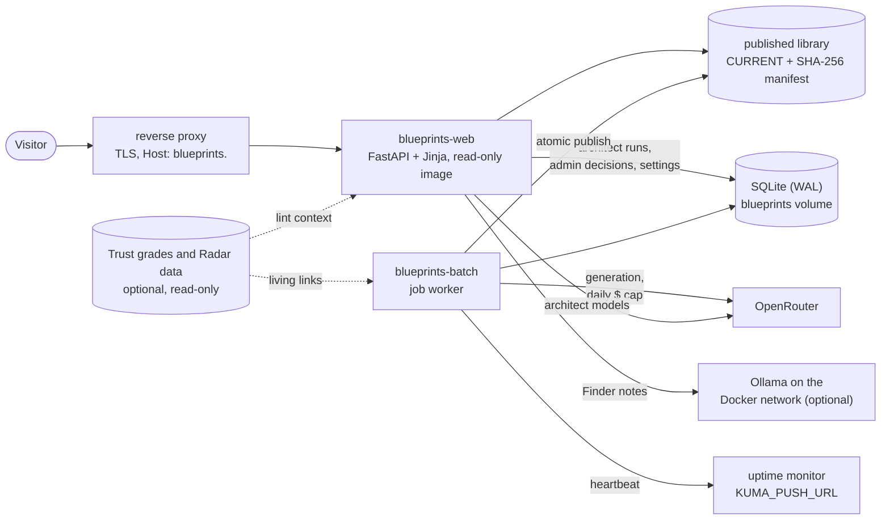
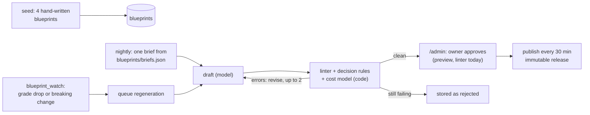
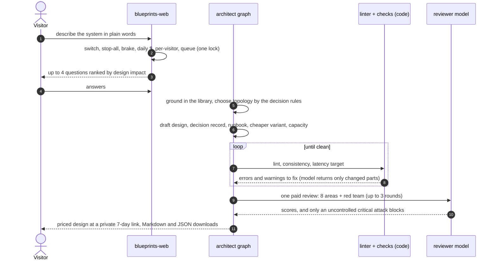

# Blueprints: architecture

How Blueprints (`blueprints.naveenlabs.tech`) is built, secured and run. This document covers Blueprints only. What
was built and when: [`HISTORY.md`](HISTORY.md). A visual walkthrough for presenting: [`explainer.html`](explainer.html)
(open it in a browser; the 3D views need an internet connection for three.js).

Last reviewed: 2026-10-09.

## 1. What Blueprints does

| Feature | Where | How |
|---|---|---|
| Library | `/`, `/b/<id>` | Reference architectures for AI agents: why-trace, components, failure modes, threats, eval plan, cost with volume and token sliders, flow diagram |
| Patterns | `/patterns` | The pattern catalogue the decision rules draw on |
| Finder | `/finder` | A requirements profile goes in; the decision rules pick the topology and mandatory controls and list the nearest blueprints |
| Compare | `/compare` | Two blueprints side by side, differences highlighted |
| Runnable starter | `/b/<id>/starter/...` | A LangGraph skeleton generated by code from the blueprint, pinned and symbol-checked |
| Custom (bring your own key) | `/custom` | The visitor's browser drafts a blueprint with the visitor's key; the server only builds the prompt and judges the draft |
| Lint API | `POST /api/lint-blueprint` | Lint, decision and cost for any blueprint JSON (200 KB max, rate limited) |
| Architect agent | `/architect` | Turns a plain-words description into a checked, priced design (section 4) |

The rule that runs through all of it: **models draft, code decides.** The linter, the decision rules and the cost
model are code; nothing a model writes is published until it passes them and the owner approves it.

## 2. Containers and data



- **web** serves the library, the APIs and the Architect agent (background threads).
- **batch** runs the durable job worker (leases, cached stages, backoff, dead-letter).
- **Optional inputs** (`docker-compose.siblings.yml` mounts them read-only): tool grades (`TRUST_DATA_ROOT`) and
  package and API data (`RADAR_DATA_ROOT`). With them, components show grades, starters are symbol-checked and a grade
  drop or breaking change flags affected blueprints. Without them Blueprints works and shows its empty states.
- Finder's short adaptation note uses an Ollama server on the Docker network when present; it is `null` otherwise.

## 3. Generation and publishing (batch)



- **Model:** one paid model on OpenRouter (`BATCH_MODEL`, data collection denied) under a daily dollar cap
  (`BATCH_DAILY_USD`, default $0.03; one generation is about five calls, about three cents). When the cap is reached
  the job waits for the next UTC day; rate-limited calls retry in minutes; over-long text is cut to the schema's limits.
- **Current state (2026-10-11):** batch is switched off in the owner's console, so no new drafts are generated while the
  3 existing drafts wait for review.
- **Prices** live in `blueprints/pricing.json` with source and date; a table older than 45 days is flagged stale.
- A blueprint that fails today's linter, has a refresh queued or is priced from a stale table is shown with a banner,
  never hidden.

## 4. The Architect agent (`/architect`)



- **Models:** DeepSeek drafts, records and fixes (`ARCHITECT_FAST_MODELS`); GLM reviews (`ARCHITECT_STRONG_MODELS`,
  low reasoning effort); data collection denied. A free model in `ARCHITECT_PUBLIC_MODELS` would run only after the
  visitor ticks a consent box (none is set).
- **Limits** (defaults in `.env`, changeable from the owner's console): $0.20 and 15 minutes per design, $0.25 per
  day, runs per visitor per day, runs at once and a queue.
- **Shared agent runtime** (`core/agent/`): gateway with budgets, backup model and real cost; run store and runner;
  server-sent events that survive a reload. A restart marks designs in flight as failed. Visitor keys are salted.

## 5. Owner controls

Stored in Blueprints' own database (`core/control/`): `architect.enabled`, `.daily_usd`, `.run_usd`, `.per_ip_day`,
`.concurrent`, `.queue`; `batch.enabled`, `batch.daily_usd`; `global.brake_pct` (pause paid work past this % of the
OpenRouter key's weekly limit, default 90); `global.stop_all`. Overrides beat the `.env` default until cleared; every
change is stored with a note. The owner's private console uses `/internal/control` (404 through the proxy, without
the token, or when `CONTROL_TOKEN` is unset).
Its report also lists the latest 20 agent runs and batch jobs as metadata only (when, mode, outcome, duration, cost,
job type, a short error); never the visitor's input, their hashed address, the job payload or the run id, which is the
private result link.

## 6. Security

| Threat | Control |
|---|---|
| Interception | TLS; HTTP to HTTPS; HSTS one year with subdomains |
| Script injection | Strict CSP, no inline code; auto-escaping templates. `/custom` alone may connect to the model provider, from the browser |
| Clickjacking | `frame-ancestors 'none'`, `X-Frame-Options: DENY` |
| Flooding and bad bodies | Per-IP limits applied before validation, 200 KB body cap, NaN and oversized numbers refused, concurrency gate |
| Runaway model spend | Per-run budget before every call; daily caps; weekly brake; stop-all; the key's own weekly limit |
| Admin takeover | `/admin` 404 without a 16+ character password; rate-limited, constant-time, same-origin |
| Unreviewed content | Nothing generated is published without passing the linter and the owner's approval |
| Visitor keys (`/custom`) | Used only in the visitor's browser; never sent to or stored by this site |
| Container breakout | Non-root, read-only web filesystem, no capabilities, `no-new-privileges`, CPU and memory limits |
| Leaked secrets | `.env` / `batch.env` on the server only (mode 600) |

## 7. Reliability

| Failure | What happens |
|---|---|
| web unhealthy | `/healthz` fails; external probe alerts; restart the container |
| Crash | `restart: unless-stopped`; leased jobs return; architect runs in flight marked failed |
| Generation keeps failing the linter | Stored as rejected after two revisions; nothing is published |
| Daily cap or model outage | Generation waits for the next day; the published library is unaffected |
| Weekly budget nearly used | Brake pauses new designs and generation with a message |
| Optional inputs missing | Empty states, no starters; no errors |
| Bad release | Hash check refuses it; point `CURRENT` back at one of the last 10 |
| Worker silent | Heartbeats stop; the uptime monitor marks the worker down after about 30 minutes |

Data: one SQLite database (WAL) in Blueprints' volume, backed up nightly by the server's backup job.

## 8. Operations

Written in ASD-STE100 style (Simplified Technical English): one instruction in each step, active voice, short
sentences. Do all the steps on the server, as root.

### Procedure 1: Deploy a new version

1. Go to the Blueprints folder:

   ```bash
   cd /opt/blueprints
   ```

2. Write down the current commit. You need it if you must go back (Procedure 2).

   ```bash
   git rev-parse --short HEAD
   ```

3. Get the new version:

   ```bash
   git pull
   ```

4. Build and start the app. Use the two `-f` flags.

   CAUTION: Without the two `-f` flags, the app does not get its optional read-only data.

   ```bash
   docker compose -f docker-compose.yml -f docker-compose.siblings.yml up -d --build
   ```

5. Make sure that the web container is healthy. Do this command until it shows `healthy` (about 30 seconds).

   ```bash
   docker inspect -f '{{.State.Health.Status}}' blueprints-web-1
   ```

6. Make sure that the worker started without errors. The command must show `0`.

   ```bash
   docker logs --since 2m blueprints-batch-1 2>&1 | grep -c Traceback
   ```

   If the command shows more than `0`, read the log (`docker logs --since 2m blueprints-batch-1`). A missing package
   usually means that `requirements.txt` was not made again after a dependency change.

7. Make sure that the public site answers. The command must show `200`.

   ```bash
   curl -s -o /dev/null -w '%{http_code}\n' https://blueprints.naveenlabs.tech/healthz
   ```

8. Do this step only on the first deploy. Publish the library one time.

   ```bash
   docker exec blueprints-batch-1 python -m blueprints.cli publish
   ```

### Procedure 2: Go back to the previous version

Use this procedure if Procedure 1 fails at step 5, 6 or 7.

1. Go to the Blueprints folder (`cd /opt/blueprints`).
2. Get the commit that you wrote down in Procedure 1, step 2:

   ```bash
   git checkout <commit>
   ```

3. Do Procedure 1, steps 4 to 7 again.

### Procedure 3: Stop the Architect immediately

Use this procedure if the Architect costs too much or gives bad results. The agent stops when any one of its switches
is off. Designs that started before continue to their limits.

1. Open `https://blueprints.naveenlabs.tech/admin` and log in.
2. Push "Turn new designs off".
3. Open `https://blueprints.naveenlabs.tech/architect`. Make sure that it shows "The architect is not taking new
   designs right now".

To keep the Architect off after a restart, also set `ARCHITECT_ENABLED=0` in `/opt/blueprints/.env`. Then do this
command:

```bash
docker compose -f docker-compose.yml -f docker-compose.siblings.yml up -d --force-recreate web
```

CAUTION: If the owner's control console has an override that sets `architect.enabled` to on, the `.env` value has no
effect. The switch in `/admin` always works.

To stop all paid work in Blueprints (agent and batch), set "stop all" in the control console.

### Settings

`.env.example` lists every setting. Shared code comes from the `atlas` monorepo (`CORE_VERSION`; `scripts/sync_core.py --check`).

## 9. Quality gates

- About 720 tests in CI on every push.
- Library evaluation (`python -m evals.blueprints_eval`) at 1.00.
- Architect launch gate (`python -m evals.architect_eval`, real models, run by hand): 8/8 passed at $0.024 mean and
  166 s mean before it was switched on.
